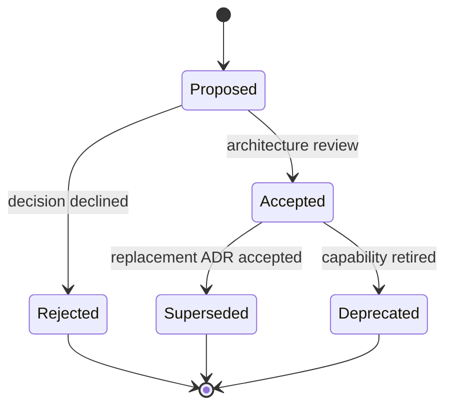

# Architecture decision records

Architecture decision records capture consequential choices, their context,
alternatives, and verification. Accepted records are constraints until they are
superseded by a later ADR; editing history in place should be limited to factual
corrections and links.

| ADR                                      | Status   | Decision                                                                           |
| ---------------------------------------- | -------- | ---------------------------------------------------------------------------------- |
| [001](001-ralph-meta-orchestrator.md)    | Accepted | Use a bounded Ralph meta-orchestrator around the analysis graph.                   |
| [002](002-evidence-snapshot-boundary.md) | Accepted | Treat search as discovery and promote only safely captured page content.           |
| [003](003-sqlite-run-store.md)           | Accepted | Use a local SQLite audit store with append-only provenance records.                |
| [004](004-local-api-and-ui.md)           | Accepted | Expose a loopback FastAPI API and a separate vinext analyst console.               |
| [005](005-model-profiles.md)             | Accepted | Qualify exact oMLX profiles; Qwen/DeepSeek remain candidates until their full gates pass. |
| [006](006-human-publication-gate.md)     | Accepted | Require content-bound, cross-functional approval before publication.               |
| [007](007-strict-domain-contracts.md) | Accepted (retrospective) | Make strict, validated Pydantic contracts the only shape model output can take. |
| [008](008-deterministic-economics.md) | Accepted (retrospective) | Compute NPV, ROI, payback, and cost of delay in Python from finance-owned ranges, never in the model. |
| [009](009-egress-policy.md) | Accepted (retrospective) | Validate every outbound query with a deterministic policy and keep confidential context away from research workers. |
| [010](010-bounded-deep-agent-research.md) | Accepted (retrospective) | Run one locked-down Deep Agent per force: one search batch of at most five queries, then forced typed output. |
| [011](011-langgraph-five-force-workflow.md) | Accepted (retrospective) | Let a deterministic LangGraph own ordering, five-force fan-out/fan-in, and a single bounded repair; runtimes own prompts. |
| [012](012-offline-demo-runtime.md) | Accepted (retrospective) | Ship a deterministic demo runtime that exercises the real graph with clearly labelled synthetic evidence. |
| [013](013-json-schema-structured-output.md) | Accepted (retrospective) | Request every model artifact through JSON-schema structured output and fail the run on any contract violation. |
| [014](014-policy-owned-source-scores.md) | Accepted (retrospective) | Classify captured sources and assign quality scores in code from the URL, never from the model. |
| [015](015-evidence-utility-thresholds.md) | Accepted (retrospective) | Gate material claims with a transparent multiplicative score and fixed thresholds that are labelled as triage, not truth. |
| [016](016-keyless-fallback-search.md) | Accepted (retrospective) | Provide Brave/Bing fallback discovery that is trusted only on non-empty results; it is not wired into the default path. |
| [017](017-vinext-starter-ui.md) | Accepted (retrospective) | Build the console from a vinext starter; keep its Cloudflare, D1, and ChatGPT sign-in scaffolding dormant and run locally behind an /api proxy. |
| [018](018-python-toolchain-and-pins.md) | Accepted (retrospective) | Use Python 3.12 with uv and hatchling, strict mypy and ruff, and pin the integrations whose internals the code depends on. |
| [019](019-apache-2-license.md) | Accepted (retrospective) | Publish the repository under the Apache License 2.0. |

ADRs 007-019 were written retrospectively on 2026-10-30 from the repository at
`8ca5edb`. Where the reason for a decision is not recorded in the repository,
the record says so and the gap is tracked in
[`docs/assumptions.md`](../../assumptions.md).

## Lifecycle

